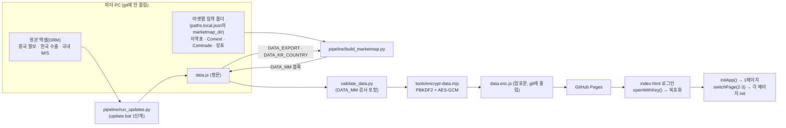
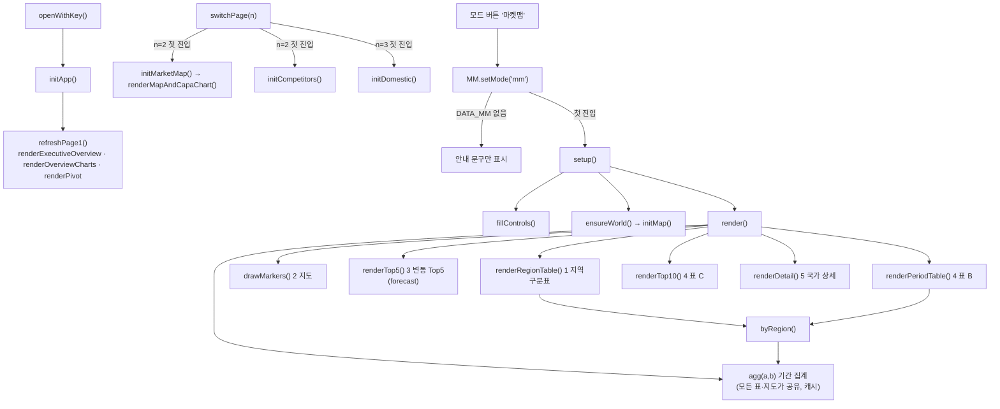
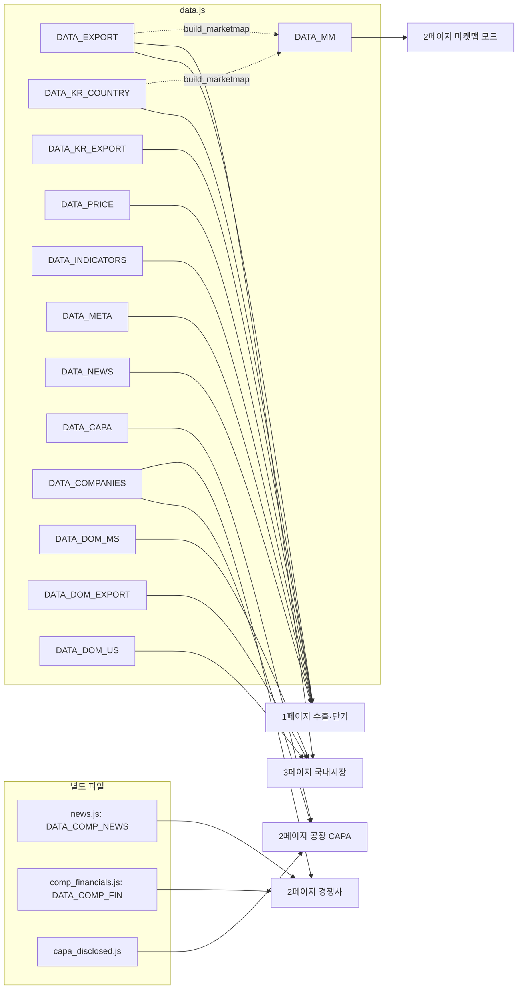

# 코드 지도 (pnwdashboard)

2026-11-12 기준. 줄 번호는 이 날의 `index.html`(2,830줄) 기준이며, 고치면 밀린다. 찾을 때는 구획 표식(`[PAGE 1]`, `[PAGE 2-B]` 등)으로 검색한다.

## 1. 데이터 흐름: 원본 → 화면

배포 배치 두 개:
- `pipeline/update.bat` = 원본 엑셀 갱신 전체(run_updates → validate → 암호화 → push).
- `pipeline/deploy_marketmap.bat` = 마켓맵만(build_marketmap → validate → 비밀번호 입력 → 암호화 → `data.enc.js`만 commit → push).

## 2. index.html 구획과 주요 함수

| 구획 | 줄(대략) | 내용 |
|---|---|---|
| `<head>` 스크립트 | 1–21 | Tailwind·Chart.js(CDN), Leaflet·topojson(vendor), `data.enc.js`, `news.js`, `capa_disclosed.js`, `comp_financials.js` |
| `<style>` | 22–171 | 공통 토큰(`--kr`, `--cn` …), `.card` `.panel` `.tbl` `.seg` `.pill-btn`, `[PAGE 2-B]` 전용 `#mmSection …` |
| 로그인 화면 | 176–190 | `#lockScreen` |
| `[PAGE 1]` HTML | 214–442 | 수출·단가, 국가 피벗, 메일 초안 |
| `[PAGE 2]` HTML | 443–663 | 모드 전환 버튼, `[PAGE 2-B]` `#mmSection`(마켓맵), `#capaSection`(공장 CAPA), 경쟁사 실적·동향 |
| `[PAGE 3]` HTML | 664–791 | 국내시장 |
| 공통 스크립트 | 792–2287 | `STATE`, 1페이지 함수, CAPA 지도(`initMarketMap` 1370, `renderMapAndCapaChart` 1519), 경쟁사(`initCompetitors` 1863), `switchPage` 2170, 로그인(`openWithKey` 2233) |
| `[PAGE 2-B]` 스크립트 | 2289–2646 | `const MM` 모듈(마켓맵 모드). 전역 이름은 `MM` 하나 |
| `[PAGE 3]` 스크립트 | 2648–2828 | `initDomestic()` |

마켓맵 지도는 CAPA 지도(`leafletMap`, `#millMap`)와 다른 Leaflet 인스턴스(`#mmMap`)다. 모드를 바꾸면 한쪽 구획을 숨기기만 한다.

## 3. DATA_* 블록 → 쓰는 화면

`DATA_MM` 모양(`build_marketmap.py`): `version`, `built`, `latest`(세 자료 공통 최신월, 월 번호 = 연×12+월−1), `range`(cn·kr·eu), `series`(7계열), `regions`(24권역), `countries`(ko·en·pt·rg·rs), `rows`([월, 나라, 계열, 톤, 금액]), `asia`(일본·인도 연간 참고), `deck`(장표), `unmapped`, `check`(원자료 합계).

## 4. 파일별 한 줄 설명

| 파일 | 설명 |
|---|---|
| `index.html` | 화면 전체(빌드 없음). 로그인 → 복호화 → 3페이지 |
| `data.js` | 평문 데이터. git 제외(`.gitignore`) |
| `data.enc.js` | `data.js`의 암호문. 이것만 올린다 |
| `news.js` | 경쟁사 주간 헤드라인(`DATA_COMP_NEWS`) |
| `comp_financials.js` | 경쟁사 분기 실적(`DATA_COMP_FIN`) |
| `capa_disclosed.js` | 공장별 공시 CAPA |
| `dashboard_logic.js` | 옛 Top-Down 로직. 지금 `index.html`이 불러오지 않는다 |
| `validate_data.py` | `data.js` 필수 블록 검사 + `DATA_MM` 검사(합계·미배정 1천톤 문턱) |
| `pipeline/run_updates.py` | 원본 엑셀 → 마스터 엑셀 갱신 → `data.js` 블록 생성(`inject_js_blocks`) |
| `pipeline/build_marketmap.py` | 마켓맵 입력 → `DATA_MM` 블록 |
| `pipeline/update.bat` | 전체 월간 갱신·배포 |
| `pipeline/deploy_marketmap.bat` | 마켓맵만 배포(비밀번호를 그 창에서 입력) |
| `pipeline/paths.example.json` | 경로 설정 예시. 실제 값은 `paths.local.json`(git 제외) |
| `pipeline/국가_마스터.csv` | 국가 표준명·한국 12권역·별칭 |
| `tools/encrypt-data.mjs` | 암호화(Node). `tools/encrypt.html` = 브라우저용 |
| `vendor/` | Leaflet, topojson, world-50m(국가 경계) |

## 5. 어디를 고치면 되나

| 바꾸고 싶은 것 | 고칠 곳 |
|---|---|
| 나라의 한솔 24권역 | 마켓맵 입력 폴더 `scripts/hansol_region_map_261112.json`(1순위) → `marketmap_country_base.json`의 `l`·`rg`. 코드 변환 규칙은 `build_marketmap.py`의 `L_FIX`·`CN2H` |
| 24권역 목록·순서 | `build_marketmap.py`의 `REGIONS` (화면은 `DATA_MM.regions`를 그대로 씀) |
| 계열(회사) 추가·이름 | `build_marketmap.py`의 `SERIES`·`COMP`, 화면 색은 `MM` 안 `COL` |
| 기준월 규칙 | `build_marketmap.py`의 `latest` 계산 |
| 지역구분표 열 추가·표시 모드 | `MM` 안 `renderRegionTable()`(열 = `head`·`row`, 칸 값 = `one()`) |
| 기간 집계 방식 | `MM` 안 `agg()` 한 곳 |
| Top5 기준·문장 양식 | `MM` 안 `renderTop5()`(5천톤 문턱, `line()`), 연간 예상 = `forecast()` |
| 표 B 기간(분기·반기) | `MM` 안 `renderPeriodTable()`의 `P` |
| 지도 원 크기·줌 단계 | `MM` 안 `drawMarkers()`(줌 4 미만 = 지역 원) |
| 국가 상세 장표 값 | 마켓맵 입력 폴더 `데이터_공급국/deck_input.json` |
| 검증 문턱 | `validate_data.py`의 `MM_LIMIT_T` |
| 공장 CAPA 지도 | `initMarketMap()`·`renderMapAndCapaChart()` (마켓맵과 별개) |
